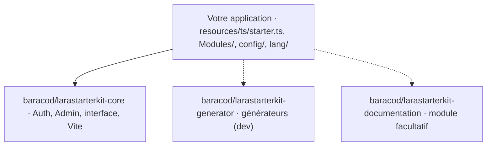

# Concepts

## Le socle et l'application

Une application Larastarterkit est une application Laravel ordinaire qui installe le socle par Composer :

- Le **socle** (core) vit dans `vendor/`. Son backend et son frontend voyagent dans le même paquet Composer : aucun paquet npm Baracod n'est nécessaire.
- L'**application** possède ses fichiers : configuration, modules locaux, traductions, `resources/ts/starter.ts` et éventuelles surcharges. Une mise à jour du socle ne les réécrit jamais.
- Règle d'or : **ne modifiez jamais `vendor/`**. Tout ce qui doit changer passe par un [point d'extension](./extension).

## Les modules

Un module est une unité fonctionnelle décrite par un manifeste `module.json` :

| Type | Emplacement | Exemple |
| --- | --- | --- |
| Obligatoire | dans le socle | Auth, Admin |
| Paquet Composer | `vendor/…`, déclaré dans `extra.larastarterkit.modules` | Documentation |
| Local | `Modules/<Nom>` de l'application | vos modules métier |

Chaque module apporte son backend (`app/`, routes, migrations, seeders, traductions) et son frontend (`resources/ts` : pages, composants, menus, locales). Les modules optionnels s'activent et se désactivent ; la désactivation conserve les données. Voir [Créer un module](./modules).

## Le frontend

Vite compile ensemble les sources du socle (depuis `vendor/`), celles des modules et celles de l'application :

- les pages de chaque module sont routées sous son nom en minuscules (`Modules/Shop/resources/ts/pages/products/index.vue` → `/shop/products`) ;
- les alias `@` (interface commune), `@app` (application) et `@<module>` (chaque module) sont disponibles en TypeScript ;
- Vue, vue-router, Pinia, vue-i18n et les composants Core sont auto-importés ;
- le module virtuel `virtual:larastarterkit` injecte les menus, traductions et l'extension `starter.ts` de l'application.

## Permissions

Une permission est identifiée par une clé et un couple `action` / `subject` (par exemple `browse` / `auth_users`). Le même couple protège l'API (middleware `ability:browse,auth_users`) et l'interface (CASL : `$can('browse', 'auth_users')`). Le rôle `administrator` possède tous les droits actuels et futurs. Voir [Auth et Admin](./auth-admin).

## Cycle de vie

| Étape | Commande |
| --- | --- |
| Créer l'application | `composer create-project baracod/larastarterkit mon_application` |
| Initialiser la base | `php artisan larastarterkit:install --no-interaction` |
| Diagnostiquer | `php artisan larastarterkit:doctor --no-interaction` |
| Mettre à jour | `php artisan larastarterkit:upgrade --no-interaction` |

Les migrations et seeders sont idempotents et ne suppriment pas de données. Le starter vise des **bases neuves** : ne lancez pas ses migrations sur la base d'une autre application.
