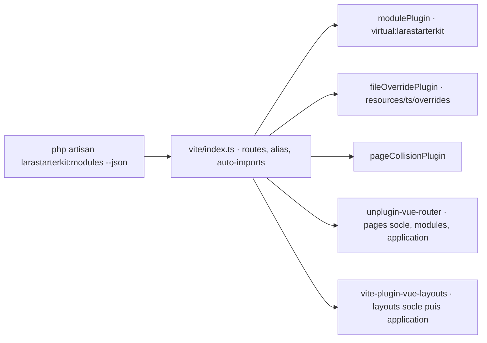

# Maintenir : architecture interne

## Démarrage du backend

`Baracod\Larastarterkit\Core\Providers\CoreServiceProvider` est découvert par Laravel (paquet Composer).

**`register()`**

1. Fusionne chaque `packages/core/config/*.php` avec la configuration de l'application (`mergeConfigFrom`) : l'application peut redéfinir les clés de premier niveau.
2. Enregistre `ModuleRegistry` (singleton) et configure le scan de nwidart/laravel-modules sur les dossiers des modules trouvés.
3. Enregistre `AppServiceProvider`, `DocumentsServiceProvider` (registre des contextes documentaires) et `HorizonServiceProvider`.

**`boot()`** ajoute les traductions du frontend commun, enregistre les vues sous l'espace `larastarterkit` (une vue de même nom dans l'application l'emporte) et les commandes `larastarterkit:*` et `starter:*`.

### Registre des modules

`Support\ModuleRegistry` réunit :

- les **paquets Composer** dont le `composer.json` contient `extra.larastarterkit.modules` ; le scan est mis en cache dans `bootstrap/cache/larastarterkit-packages.json`, invalidé quand Composer réécrit `vendor/composer/installed.php` ;
- les **modules locaux** de `Modules/`.

`statuses()` lit `modules_statuses.json` ; Auth et Admin sont toujours actifs. `requires` est vérifié : un module actif dont une dépendance est absente ou inactive lève une erreur. Chaque module charge ensuite ses providers (`module.json`), qui enregistrent routes, migrations, traductions (`Support\ModuleTranslations`) et politiques.

### Cycle de vie

`Support\StarterLifecycle` porte `install` et `upgrade` : `migrate --force`, puis, dans une transaction, les `upgradeSeeders` de chaque module actif. Un échec de migration arrête tout avant les seeders. Tout seeder listé doit être idempotent et préserver les données.

### Points d'entrée publics

- `Larastarterkit::userModel()`, `newUserQuery()`, `newUser()` : résolution du modèle utilisateur depuis `auth.providers.users.model`. Le cœur ne référence jamais directement `Modules\Auth\Models\User` pour une requête ou une instanciation. `registerUserMorphAlias()` garde le type polymorphe historique quand l'application utilise son propre modèle.
- Contrôleurs et services créés par le conteneur : une application peut les lier à une sous-classe.

## Construction du frontend

Le `vite.config.ts` d'une application réexporte `packages/core/frontend/vite/index.ts`.

| Élément | Fichier | Rôle |
| --- | --- | --- |
| Registre | `vite/modules.ts` `installedModules()` | Liste des modules et de leurs sources frontend (appel PHP au démarrage) |
| Module virtuel | `modulePlugin` | Expose `moduleMenus`, `moduleMessages`, `moduleCatalog`, `initialModuleStatuses`, `navbarComponents` et `applicationExtension` (le `starter.ts` de l'application) ; écrit l'empreinte `larastarterkit.json` au build |
| Surcharges | `fileOverridePlugin` | Redirige à la résolution un import vers `resources/ts/overrides/<racine>/<chemin>` ; l'importateur qui est la surcharge garde l'original ; les blocs d'un SFC (`?vue&type=…`) ne sont jamais redirigés ; redémarre Vite quand une surcharge est ajoutée ou supprimée |
| Collisions | `pageCollisionPlugin` | Avertit (ou échoue avec `LARASTARTERKIT_STRICT_PAGES=true`) quand deux pages donnent la même URL |
| Routes | `VueRouter({ routesFolder })` | Pages du socle (racine), des modules (`<module>/`) et de l'application (racine) |
| Layouts | `Layouts({ layoutsDirs })` | Socle puis application : le dernier dossier l'emporte |
| Alias | `resolve.alias` | `@`, `@core`, `@layouts`, `@app`, `@<module>`… |
| TypeScript | `larastarterkit:frontend` | Génère `.larastarterkit/tsconfig.json` avec les mêmes alias |

## Exécution du frontend

`resources/ts/main.ts` crée l'application, enregistre les plugins (`plugins/*`, dans l'ordre de leur préfixe numérique), fournit les slots de `starter.ts`, appelle `configure(app)` puis monte l'application.

Le routeur (`plugins/1.router`) applique les remplacements de pages de `starter.ts` **avant** les layouts, puis ses gardes, dans cet ordre : modules désactivés, pages publiques, pages réservées aux invités, changement de mot de passe imposé, pages authentifiées, permission CASL de la route. Chaque redirection passe par `resolveRedirect()`.

### API d'extension frontend

`frontend/resources/ts/extension/` est découpé pour rester testable :

| Fichier | Contenu |
| --- | --- |
| `define.ts` | Types publics et `defineStarter` ; aucun import d'exécution (l'application l'importe depuis `starter.ts`) |
| `core.ts` | Fonctions pures : redirections, slots, remplacement de pages ; testées par `node:test` |
| `runtime.ts` | Les mêmes fonctions liées à `applicationExtension` du module virtuel |
| `index.ts` | Réexporte `define.ts` (`@/extension`) |

`components/StarterSlot.vue` résout un slot : un composant seul remplace le contenu par défaut, une liste de contributions s'ajoute après lui (triée par `order`, filtrée par `when`).

## Traductions

`Support\ModuleTranslations` enregistre l'espace de noms d'un module (`auth::`, `admin::`). Les fichiers du module sont toujours chargés. Un dossier historique `resources/lang/modules/<module>` de l'application remplace leurs clés une par une, et `lang/vendor/<module>/…` reste le mécanisme standard de Laravel.
