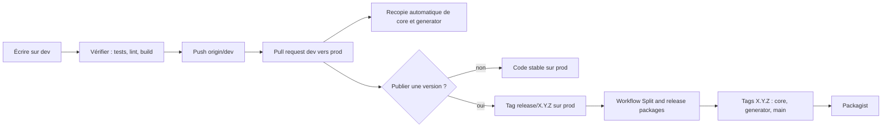

# Maintenir : publier une version



## Trois règles

1. On ne développe que dans le monorepo, sur `dev`. Les dépôts `larastarterkit-core` et `larastarterkit-generator` sont des miroirs en lecture seule.
2. On ne fusionne jamais dans `main` : c'est la branche de distribution du squelette, remplie par le workflow.
3. On ne pose un tag `release/…` qu'après avoir fusionné `dev` dans `prod`, sur le dernier commit de `prod`.

## Fusionner `dev` dans `prod`

Ouvrez une pull request de `dev` vers `prod` après les vérifications de [Qualité et tests](./maintenir-qualite). Chaque push sur `prod` recopie core et generator sur la branche `main` de leur miroir (`.github/workflows/split.yml`). Une fusion ne crée aucune version Packagist.

## Publier une version

Tous les paquets partagent une seule version.

1. Sur `dev` :

   ```sh
   php bin/set-version.php 1.0.0-rc.5
   composer update "baracod/*" --no-interaction
   ```

   Complétez `CHANGELOG.md` (section de la version), commitez, puis fusionnez dans `prod`.

2. Sur `prod` à jour :

   ```sh
   git tag release/1.0.0-rc.5
   git push origin release/1.0.0-rc.5
   ```

Le workflow « Split and release packages » vérifie que le commit appartient à `prod` et que `composer.json` porte la version, tague core et generator `1.0.0-rc.5`, puis publie `skeleton/` sur `main` avec le même tag. Les tags `release/*` ne sont pas des numéros de version : Packagist les ignore.

Le workflow utilise le secret `SPLIT_ACCESS_TOKEN`, un jeton GitHub ayant les droits d'écriture (contents) sur `larastarterkit`, `larastarterkit-core` et `larastarterkit-generator`. Le lancement manuel du workflow n'est pas utilisé.

## Branche de distribution

`main` contient `skeleton/` accompagné de `LICENSE`, `THIRD_PARTY_NOTICES.md` et `CHANGELOG.md`. Son historique est indépendant ; Packagist lit `baracod/larastarterkit` depuis cette branche et ses tags.

## Avant de taguer

- Le CHANGELOG annonce tout changement d'un élément de l'[API publique](./maintenir-api-publique), avec la note de migration.
- Une application créée depuis le squelette s'installe et se met à jour (`larastarterkit:upgrade --dry-run` puis `larastarterkit:upgrade`).
- La documentation est construite sans erreur.
